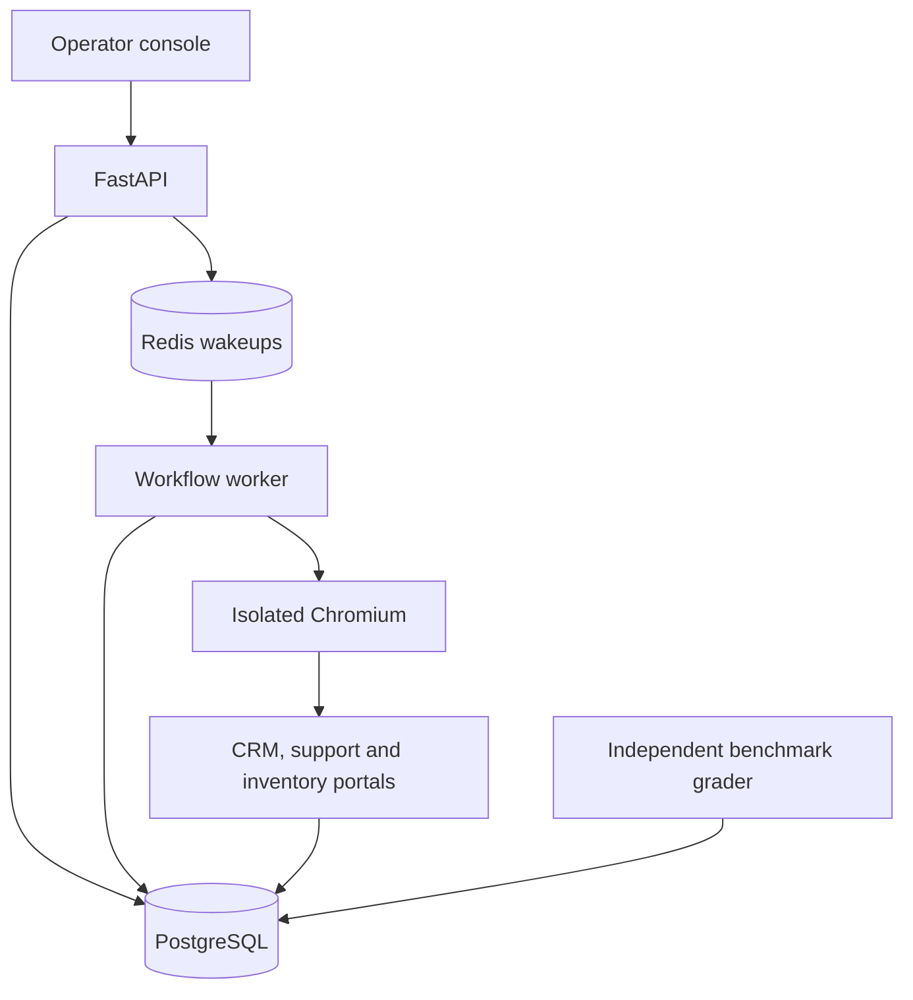
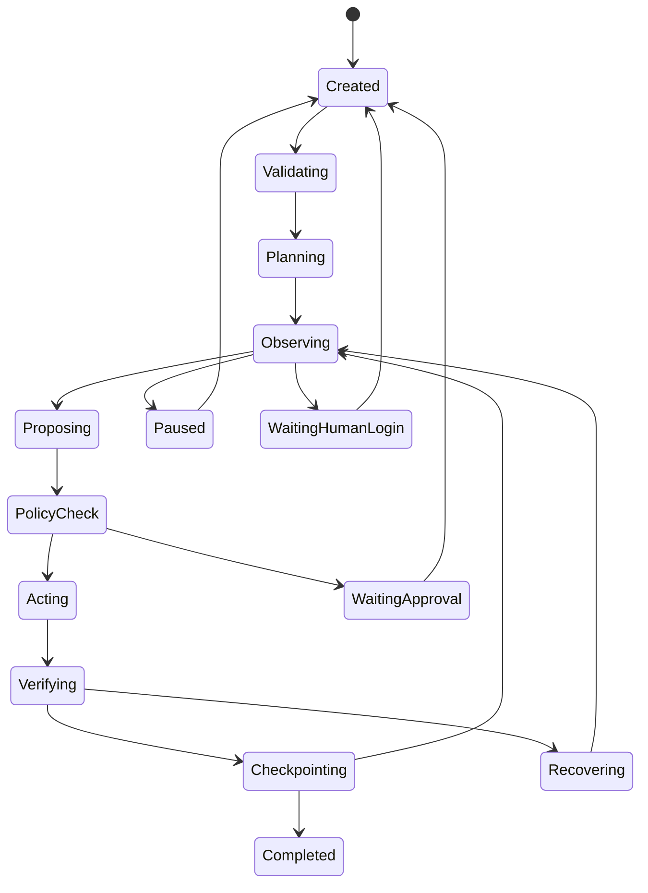

# Architecture

One FastAPI application serves the operator API and three same-origin business portals. The React console uses typed contracts and authenticated SSE. Jinja renders the independent CRM, support and inventory routes as ordinary HTML forms. The worker is a separate process.

## Persistence and queueing

SQLAlchemy Core uses short synchronous transactions. FastAPI runs synchronous handlers in its thread pool. Postgres provides row locks and skip-locked claiming. SQLite uses WAL and immediate write transactions for single-host development. Alembic provisions composite tenant foreign keys, record and audit constraints, and indexes on common lookup and lease paths.

Runs and action intents live in SQL. Redis is a bounded wakeup channel. If a wakeup is lost or Redis is unavailable, workers poll SQL and the work remains durable. A run lease is renewed on browser actions and durable transitions. A session minted for the browser is tied to that lease and the originating identity. A competing worker or expired lease cannot submit a business write.

## Workflow state and recovery

Terminal failure, cancellation, timeout and partial completion are derived from the transition rules in `bridge/contracts.py` and the verified outcome ledger. Pause and cancel are checked before consequential work. A cancelled run may report an unresolved intent if the request arrived after commit and before verification.

Each target has a tenant-scoped stable record ID and a revision. The workflow writes the exact intent and prior snapshot before attempting a mutation. The business server revalidates the identity, live lease, operation, parameters, record version and any approval. Inventory updates and its movement and audit rows commit in one transaction. After uncertain completion, a fresh page loads the matching intent-bound business audit event or movement and checks invariants. A conflicting revision closes the intent with a reason. Transient failures can retry only after a fresh read confirms the unchanged prior state.

## Perception

Playwright opens one context per run, with a 1280×820 viewport, CSS-scale screenshots and no shared cookies. Targets are selected from scoped accessible roles and names or from the screenshot adapter. DOM references bind to element handles and the observation's page version. In Vision and Hybrid fallback, the result is a bounded list of normalized points. Coordinates, visible text, confidence and an immediate DOM hit test must agree with the authorized control. The modes share the task parser, record reads, mutation policy and verifier.

The structured workflow controller handles goal planning and action sequencing. The optional multimodal model grounds approved targets. Application text cannot create operations, change the goal, or grant write permissions.

## Design decisions

| Decision | Reason |
|---|---|
| React and Vite console, server-rendered portals | The console needs streaming state. The portals use inspectable HTML forms, stable semantics and a small runtime. |
| Shared same-origin gateway | One cookie and origin policy, with server-enforced app scopes and separate portal routes. |
| Durable SQL lease with Redis wakeups | Queue notifications can be dropped without losing work. A dead worker's lease can expire and be reclaimed. |
| Fresh UI read verification | The browser executes and verifies through the business UI. The database grader can independently audit both. |
| Integer UTC seconds and stock quantities | Stable age comparisons and exact inventory conservation. |

Implementation references include the [Playwright locator guide](https://playwright.dev/python/docs/locators), [network guide](https://playwright.dev/python/docs/network), [redirect routing API](https://playwright.dev/python/docs/api/class-route), [FastAPI task guidance](https://fastapi.tiangolo.com/tutorial/background-tasks/) and [Compose startup ordering](https://docs.docker.com/compose/how-tos/startup-order/).
