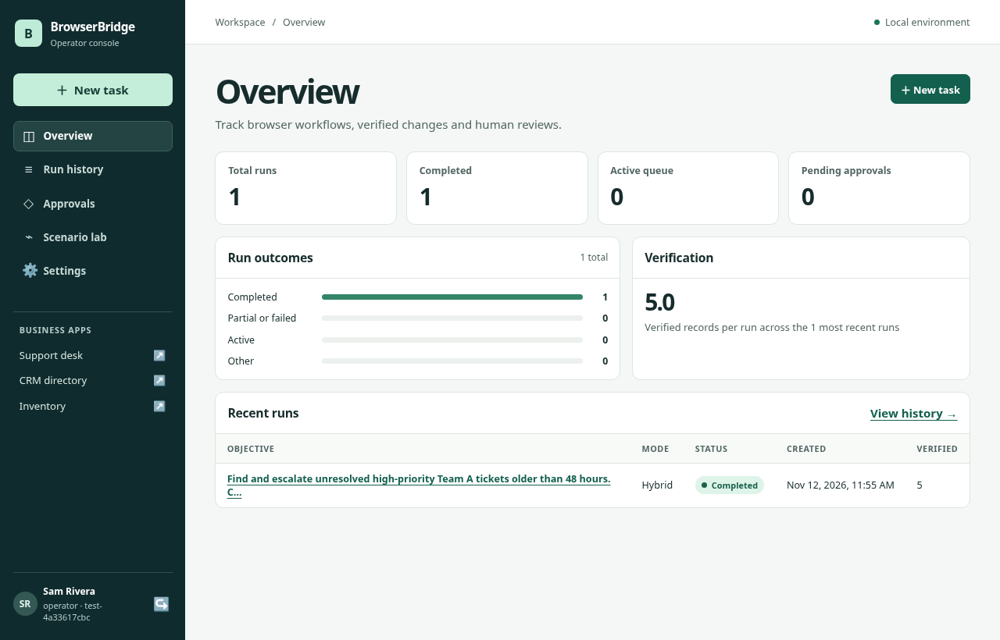
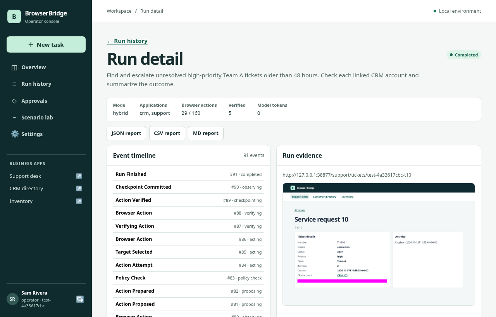

# BrowserBridge

BrowserBridge runs scoped enterprise workflows through the same web interfaces a human operator uses. It inspects support tickets and CRM accounts, checks warehouse stock, and executes authorized escalations, transfers and reorder requests. Every verified write has a durable intent, a business audit event and an independent read of the saved state.



## Start with Docker Compose

Requires Docker Engine and Docker Compose v2.24 or newer. Run these commands from the repository root.

```bash
cp .env.example .env
make up
make smoke
```

The console is at [localhost:8000](http://localhost:8000). Open the [support desk](http://localhost:8000/support), [CRM directory](http://localhost:8000/crm), [inventory portal](http://localhost:8000/inventory) and [API docs](http://localhost:8000/docs) from the same origin. PostgreSQL and Redis stay on the Compose network. The migration service upgrades the database and seeds the demo before the API starts.

| Demo identity | Account | Scope |
|---|---|---|
| Support operator | `operator@demo.test` | Team A tickets and customer summaries |
| Manager | `manager@demo.test` | Manage customer records and request inventory movements |
| Reviewer | `reviewer@demo.test` | Review another identity’s exact pending intent |
| Viewer | `viewer@demo.test` | Read access within the demo tenant |
| Separate tenant | `manager@other.test` | Independent synthetic records |

The default demo password is `demo-local-only`. Use a fresh demo database for a first-write walkthrough. A second escalation run reads the saved queues and returns verified no-ops. `make down` stops the services while retaining the volumes.

## Start without Docker

Requires Python 3.12+, Node.js 24, npm and a compatible Chromium. The standalone path defaults to a SQLite database and a SQL-polling worker. PostgreSQL and Redis can be supplied through environment variables. `BROWSER_CHROMIUM` can select an installed executable.

```bash
make local-install
make local-smoke
```

For interactive use, run `make local-api` and `make local-worker` in separate terminals. Build the React bundle before starting the API. Native scripts read shell environment variables. The Compose `.env` contains container hostnames.

## Try the workflow

1. Sign in as `operator@demo.test` and select **New task → Use demo objective**.
2. Start the run in **Hybrid** or **DOM** mode. The browser enumerates the whole support list, checks each linked CRM record and verifies the final queue, revision and business audit history on a fresh ticket read.
3. Open the event timeline and download a JSON, CSV or Markdown report. A failed or skipped item appears with its reason. A resumed worker reconciles an uncertain intent before considering a retry.
4. Sign in as `manager@demo.test` and submit `Transfer 3 units of SKU-101 from East to West`. Sign in as `reviewer@demo.test` in a second browser profile. Approve the scoped request and inspect the stock and movement history.



See the [demo walkthrough](docs/demo-walkthrough.md) for exact task examples and failure scenarios.

## Run checks and benchmarks

```bash
make lint
make test
make test-e2e
make benchmark-smoke
```

The first three targets use the local development environment. `make benchmark-smoke` runs in the Compose worker. For the native benchmark, start the API and use the CLI.

```bash
.venv/bin/python -m benchmarks.run --suite smoke --mode all --seed 42
.venv/bin/python -m benchmarks.run --suite local120 --mode hybrid --seed 42 --out benchmarks/reports/seed42
.venv/bin/python -m benchmarks.compare --input benchmarks/reports/seed42 --output benchmarks/reports/seed42/summary.md
```

The scenario lab exposes the same harness to demo managers. The harness creates an isolated synthetic tenant for every case and mode. The grader reads the database separately from the browser workflow. See [evaluation](EVALUATION.md) for measured runs, splits and metric definitions.

## Model and deployment scope

DOM and the no-key Hybrid path use deterministic workflow planning and semantic browser actions. For visual grounding, set `MODEL_NAME`, `MODEL_API_KEY` and, for a compatible custom endpoint, `MODEL_URL`. Vision sends redacted screenshots and accepts a click only after a current-page hit test agrees with the authorized control. Hybrid tries visual grounding when semantic targeting cannot identify the control. An unconfigured provider is shown as unavailable in Vision benchmarks.

BrowserBridge is designed for the three local synthetic portals and six typed goal families. See [implementation status](IMPLEMENTATION_STATUS.md) for verified checks, design choices and outstanding acceptance items.

| Path | Contents |
|---|---|
| `bridge/` | API, server-rendered portals, authorization, Playwright runtime, worker and reports |
| `console/` | React and TypeScript operator console |
| `migrations/` | Alembic schema |
| `benchmarks/` | Seeded cases, fixture harness, grader and exports |
| `tests/` | Contract, API, policy, recovery and browser tests |
| `docs/` | Deployment, security, API, walkthrough and captured screenshots |

[Architecture](ARCHITECTURE.md) · [Security](SECURITY.md) · [API](docs/api.md) · [Deployment](docs/deployment.md) · [Contributing](CONTRIBUTING.md)
