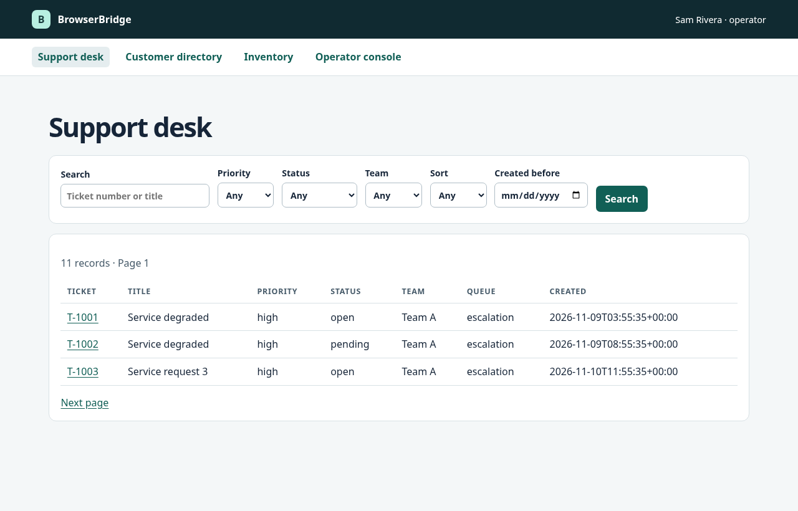

# Demo walkthrough

## Support escalation

Open the console and sign in as `operator@demo.test`. Use the sample objective under **New task**. A fresh demo starts with two tickets titled “Service degraded”, a matching record on the final page, an unresolved recent ticket and tickets assigned to another team. The browser reads all pages and matches stable ticket numbers and CRM references.

The seeded clock is the time the database was initialized. A demo ticket exactly 48 hours old at initialization may age into eligibility before submission. Benchmark fixtures use a fixed task clock and check the strict cutoff independently.

Open the report to see the prior and final queue, verified CRM IDs and evidence references. The **Support desk** activity panel shows the business event. Run the same goal again to see no-ops for records already in the queue.

## Approval-gated inventory

Use two browser profiles. In the first, sign in as `manager@demo.test` and submit `Transfer 3 units of SKU-101 from East to West`. Wait for **Waiting approval**. In the second, sign in as `reviewer@demo.test`, select **Approvals** and review the quantity and warehouse revisions. Approve and wait for the run to complete. Compare the East and West balances and check the movement history.

For a reorder, use `Reorder 5 units of SKU-102 for Central`. Approval creates a tracked request and leaves on-hand stock unchanged. Deny an approval to observe a failed result without inventory changes.

## Security and recovery

Use a manager to open **Scenario lab**. Run the **Smoke** suite in Hybrid mode with seed 42. It includes a modal layout, a committed mutation followed by an ambiguous timeout, a real worker process exit, a malicious ticket description and browser-session expiry. The grader labels the login handoff as the correct outcome. It grades successful mutations against authoritative database state.
